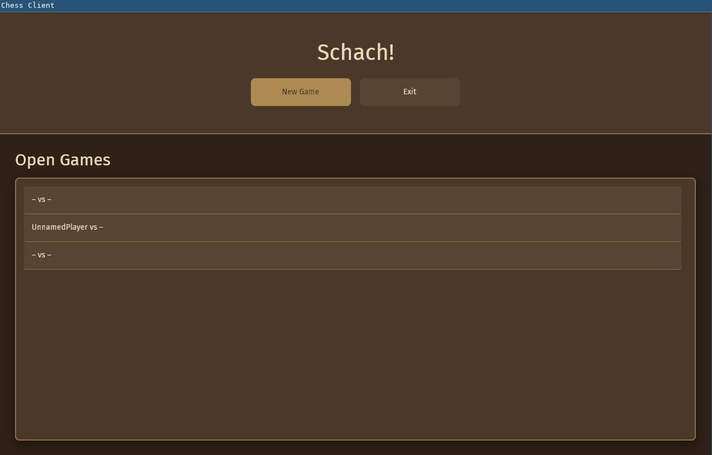
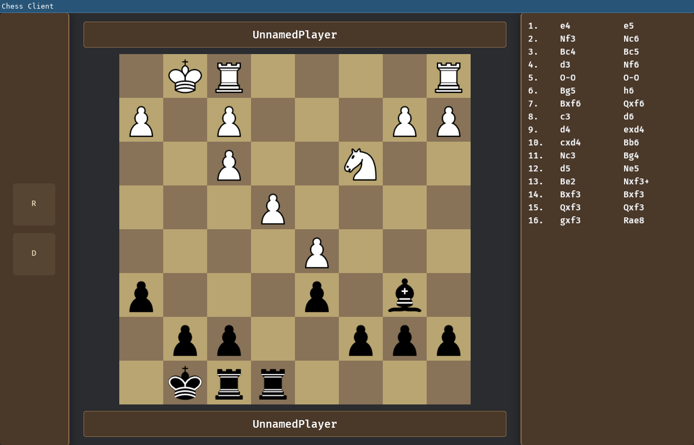
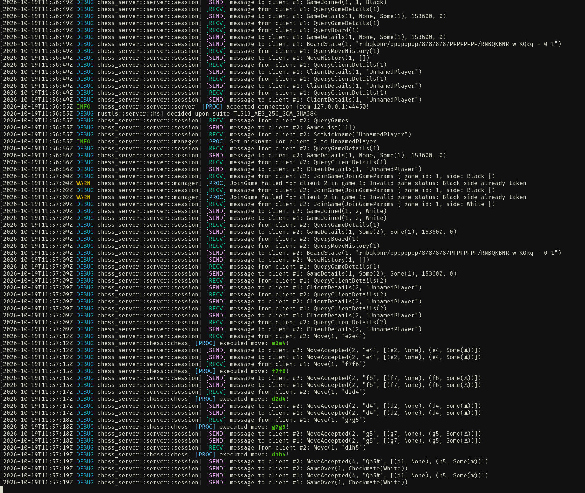

# Chess-Server (+ Bevy Client)

My personal 'everyone needs to write a chess program in his life' attempt.

A chess program as a client-server architecture. The server is responsible for all the chess logic while clients can send commands to create, join and play chess games.

The server is mostly home-grown stuff. The main external crates I use are `smol` as the async runtime, `env_logger` for logging and `rustls` for TLS encrpytion. All chess logic as well as the network protocol and its (de)-serialization is written by me. I am fairly certain at this point that there are no game logic bugs anymore; however, no advanced optimization techniques like bitboards are used.

The client obviously depends on `bevy` and is therefore unfortunately not the smallest (The release binary is over 60MB already). Due to the nature of the server, any client is a thin client though and doesn't need to understand chess rules; it only needs to implement the protocol and send moves. Therefore, even a super-small Telnet client would be possible.

There's still lots of stuff to do and I do programming only occassionally, but it is already perfectably usable to play some chess on a LAN-party!

Main Meu                   |  Chess Game
:-------------------------:|:-------------------------:
  |  

Server mechanics
----------------

## Done:

### Client-Server-Architecture
  - [x] Protocol for communicating online-chess-related messages (creating games, making moves, ...)
  - [x] Handling multiple games and clients
  - [x] TLS encryption

### Core chess logic:
  - [x] Piece movement logic
  - [x] Checkmate and stalemate detection
  - [x] 50-Moves-Rule
  - [x] Threefold-Repetition

### Expanded server-side chess game logic
  - [x] Draw by agreement
  - [x] Resigning
  - [x] Log move history
  - [x] Save games to disk
  - [x] SAN converter
  - [ ] Insufficient material draw
  - [ ] Time control management
  - [ ] UCI Bridge (Stockfish integration)
  - [ ] Persistent Accounts
  - [ ] Elo rating

### GUI Client
  - [x] Create, join and list Games
  - [x] Piece movement by clicking squares
  - [x] Promotion
  - [x] Show move history
  - [ ] Show chess clocks
  - [ ] Material overview
  - [ ] Piece movement by dragging pieces
